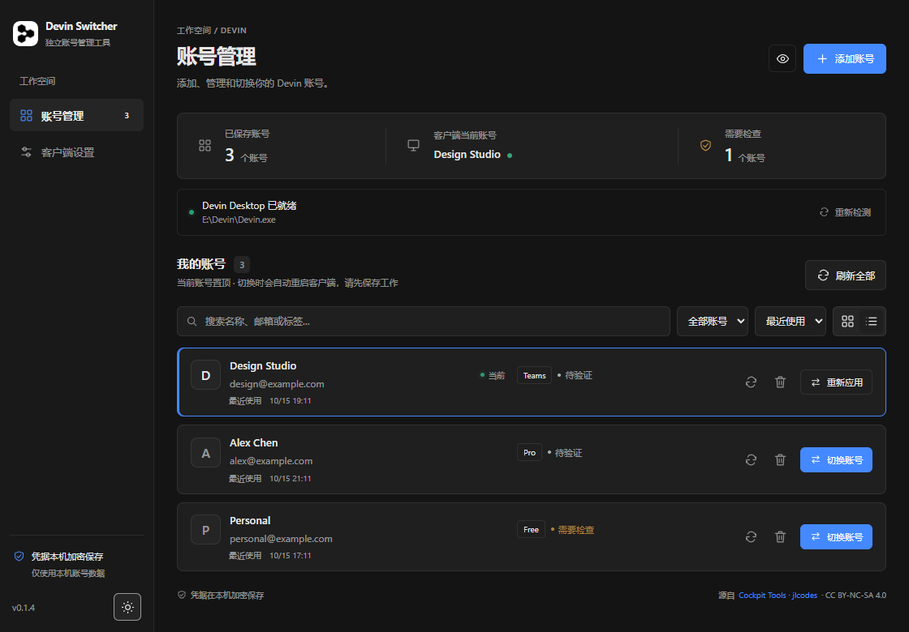

# Devin Switcher


**Windows 桌面账号管理工具 · 非官方项目**

[下载最新版本](https://github.com/sxxxxxxxxxxxxxxxxxxxxx/devin-switcher/releases/latest) · [上游 Cockpit Tools](https://github.com/jlcodes99/cockpit-tools) · [许可与署名](NOTICE.md)



从 [Cockpit Tools](https://github.com/jlcodes99/cockpit-tools) 提取的精简 Devin Desktop 账号管理应用。核心账号、导入、刷新和客户端会话注入代码来自原项目，并非重新实现一套上号协议。

## 使用（0.1.5）

1. 打开切号器，点击“添加账号 → 网页授权 → 开始网页授权”。
2. 在系统浏览器完成目标账号登录。
3. 浏览器返回本机授权页面后，切号器直接接收本次结果、兑换 IDE 凭据并保存账号，不经过 Devin 客户端。
4. 对其他账号重复上述操作，账号会保存在列表中；点击“切换”才会将对应账号写入并启动 Devin Desktop。
5. 仍支持 Token / Cockpit Tools 原格式 JSON 导入和“导入本机已登录账号”。切号前请保存编辑中的文件。

登录本身不要求启动官方客户端；实际切换 IDE 账号仍需要已安装且完成初始化的 Devin Desktop。客户端路径支持 Windows 注册表探测，找不到时可在设置中指定 Devin.exe。

### 网页授权修正依据

官方网页公开脚本对 `http://localhost:PORT/auth`、`http://127.0.0.1:PORT/auth` 有专用登录分支，编辑器登录页会对其保留网页登录而不直接跳入 Devin 客户端流程。原项目 `/windsurf-auth-callback` 没有命中这个分支。静态规则验证记录见 `docs/official-redirect-rules.json`。

本版复用 Cockpit 原有 loopback listener、随机 state、账号 payload 和存储逻辑，改用 `/auth`；采用 fragment 返回，在本机页面清除地址中的凭据后 POST 至同一本机监听器。支持原有 Token 类型、官方一次性 `ott$` / `oidc$` 兑换，以及明确的 `devin_code` 交换。GitHub 中间回调的普通 `code` 不会被当作 Devin 凭据。

没有注册或接管 `devin://`，没有修改服务端允许列表，也没有伪造新的 client_id。授权凭据不写入 pending 文件、不出现在日志中；保存的账号详情仍使用原有加密格式。

**当前验证范围：**0.1.2 发布后，用户反馈网页授权“好像这次确实有用了”；开发环境仍未独立完成真实账号的端到端登录、刷新和两账号切换验证。0.1.3 保留相同授权及凭据实现，只优化界面与管理交互。28 项后端离线回归测试通过，界面交互使用合成账号验证，详见 `docs/VALIDATION.md`。

## 0.1.5 网络连接修正

本机复现：默认环境代理 127.0.0.1:7897 连接 register.windsurf.com 时 TLS 握手 EOF；同一服务器直连可获得 HTTP 响应。浏览器收到本机回调，只代表授权结果已交付，凭据兑换成功后才会保存账号。

认证请求先沿用原系统/环境代理。仅在建立连接失败（reqwest is_connect）且请求可克隆时，保持同一 URL、请求体和 User-Agent，最多尝试一次直连；不会关闭证书或主机名验证，不修改系统代理。API 请求不自动跟随重定向；收到 HTTP 响应、连接后超时或不可克隆请求均不重发一次性凭据。错误提示只显示故障类别，不包含 Token、响应正文或授权 URL。

升级后请重新点“开始网页授权”，不要刷新旧的本机回调页。无凭据连通性检查可以证明传输可达，不能代替真实 Token 兑换和账号切换验证。

诊断命令：`cargo run --manifest-path src-tauri/Cargo.toml --example network_probe`。只向官方认证域发送无凭据 GET，不读取本地账号文件。

## 0.1.4 Devin 风格界面

- 直接参考本机 Devin Desktop 3.10.48 的 Devin Dark / Devin Light 主题资源，使用中性灰底、细边框与蓝色主操作。
- 窗口、任务栏、安装包和侧栏使用用户指定客户端随附的同款黑白图标；保留独立应用名称 Devin Switcher，品牌归属见 NOTICE。
- 收窄侧栏及顶部概览，移除装饰标语；增大账号名称、邮箱与操作文字，列表采用更紧凑行距。
- 新用户默认深色和列表视图；已有用户的主题及视图偏好继续保留。
- 隐私显示开启时同时清空搜索词，避免搜索框残留姓名或邮箱。
- 授权、导入、存储与切号 Rust 源码沿用 0.1.2 / 0.1.3。设计资源读取不修改官方客户端或登录数据。

## 0.1.3 界面与管理体验

- 参考 Cockpit Tools 的账号管理交互，增加搜索、筛选、最近使用/最近添加/名称排序及当前账号置顶。
- 网格和紧凑列表两种视图；深浅色主题；隐私显示隐藏姓名、邮箱与标签，偏好只保存在本机。
- 账号概览显示已保存数量、本地匹配的当前账号与需检查数量。待验证不等于有效；需检查包括过期提示、服务端查询错误或刷新失败，不能仅据此判断账号已失效。
- 刷新全部逐个执行，部分失败会单独标记；不因某个账号失败而中断其他账号。
- 添加弹窗提供网页登录等待/取消状态、Token 和 JSON 文件导入；支持 Escape 关闭、键盘焦点约束及小窗口布局。
- 切换会重启官方客户端，请先保存工作。当前账号可“重新应用”。

界面自动检查：启动 `npm run dev`，设置 `DEVIN_PLAYWRIGHT_PATH` 指向已安装的 Playwright 包目录（或在本地安装 Playwright 包），运行 `node scripts/ui-smoke.cjs`。使用 Edge headless 和合成 IPC 数据，不读取真实账号，不测试真实网页登录或客户端切换。

## 本地数据

数据位于 `%LOCALAPPDATA%\DevinSwitcher`，与 Cockpit Tools 数据目录分开。账号 JSON 格式和调用参数保持兼容；可通过 Cockpit Tools 导出，再导入本应用。加密封装文件需要配套密钥，不能当作普通导出 JSON 直接导入。

账号详情使用上游 AES-256-GCM 封装；Windows 新密钥增加用户级 DPAPI 保护。旧格式密钥仍能读取。新密钥不能复制到另一 Windows 用户直接解密。索引只保存基础信息。认证日志不写入磁盘。

切号前备份客户端 SQLite 数据库到 `client-backups`。备份包含客户端登录数据，请按敏感文件保护。注入操作采用事务，写入失败回滚。界面“本地当前账号”表示客户端持久化凭据匹配，不能代替远端服务验证。删除本应用账号不会注销官方客户端，也不会清理切换前备份。

## 开发与构建（Windows）

需要 Node.js、Rust MSVC 工具链、Visual Studio C++ Build Tools 和 WebView2。

```powershell
npm ci
npm run build
cargo test --manifest-path src-tauri/Cargo.toml --locked --lib -- --test-threads=1
npm run tauri -- build --bundles nsis
```

安装包生成在 `src-tauri/target/release/bundle/nsis`。独立版不需要 Go、代理 sidecar 或原项目其他平台组件。

源码分析和调用图见 [docs/ANALYSIS.md](docs/ANALYSIS.md)，验证记录见 [docs/VALIDATION.md](docs/VALIDATION.md)。真实账号授权、刷新和两账号切换尚待用户登录后验证，离线测试不等同于真实账号验证通过。

## 许可

保留原作者 jlcodes / jlcodes99 署名，遵循 CC BY-NC-SA 4.0；见 [NOTICE.md](NOTICE.md)、[LICENSE.txt](LICENSE.txt) 及保留的上游 README。

## 公开源码说明

此仓库不包含任何真实账号、Token、客户端登录数据库、密钥、OAuth pending 文件或本机运行日志。演示截图和测试使用合成数据。历史本机验证记录保留验证范围说明；运行日志未随公开源码发布。
