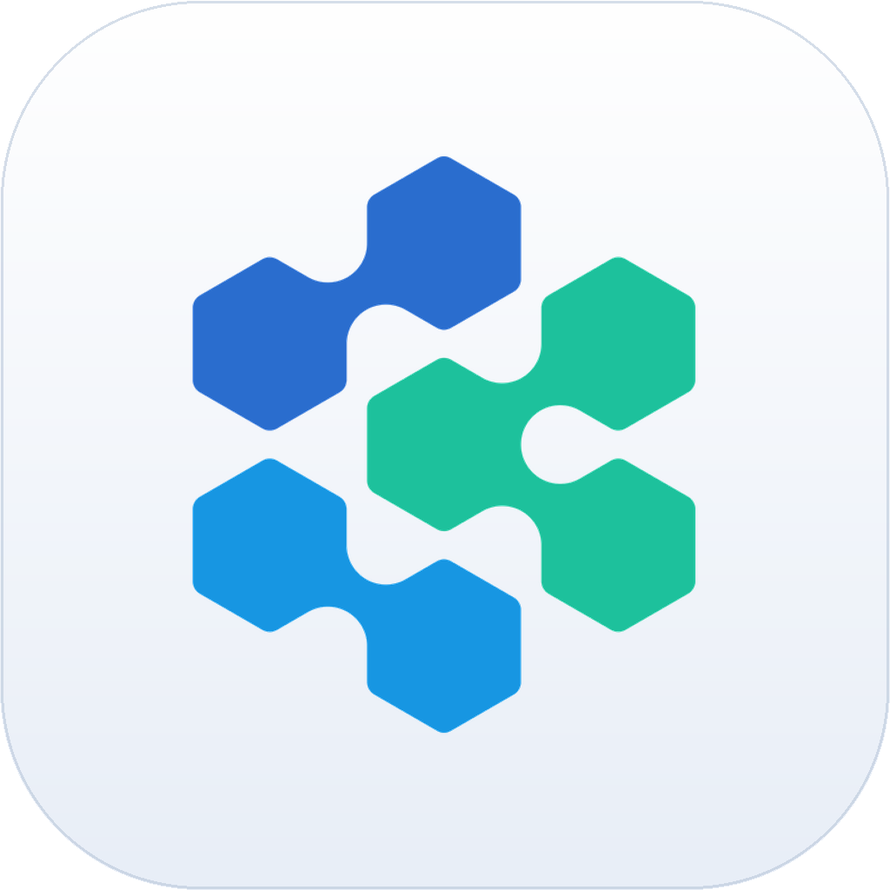
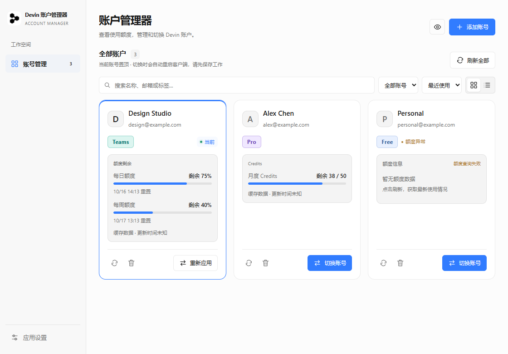
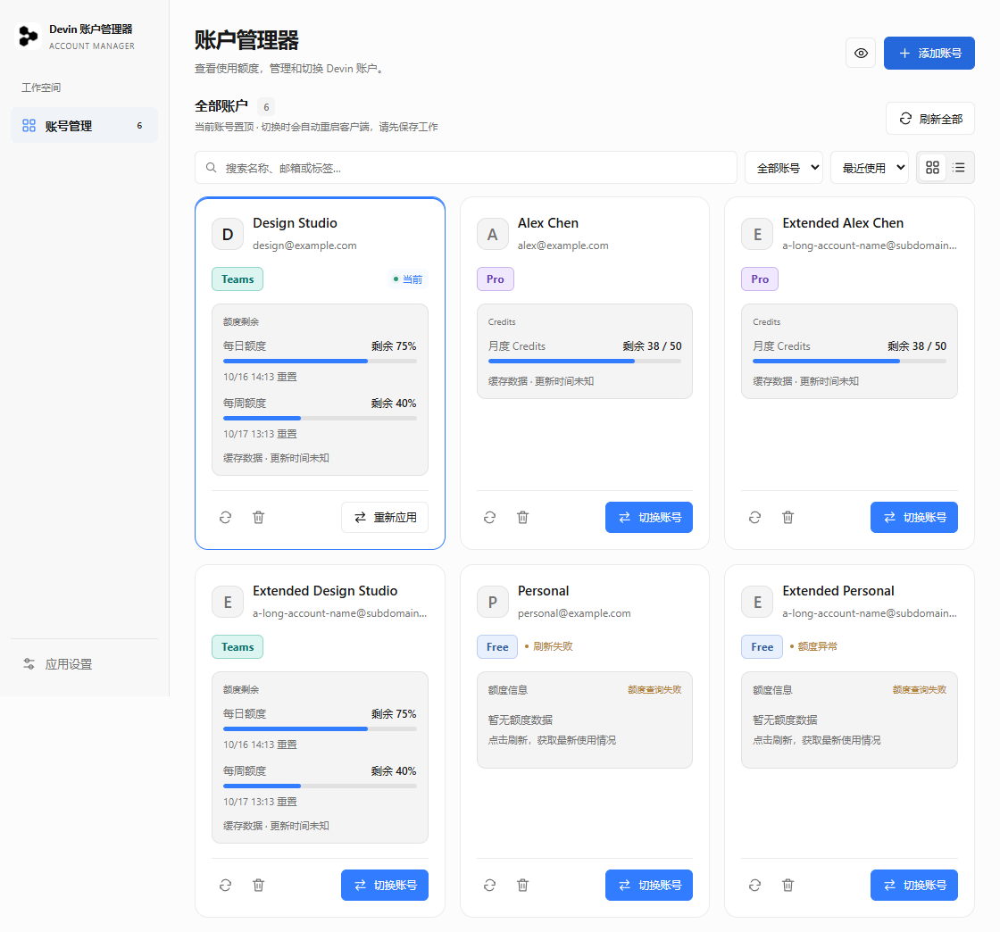
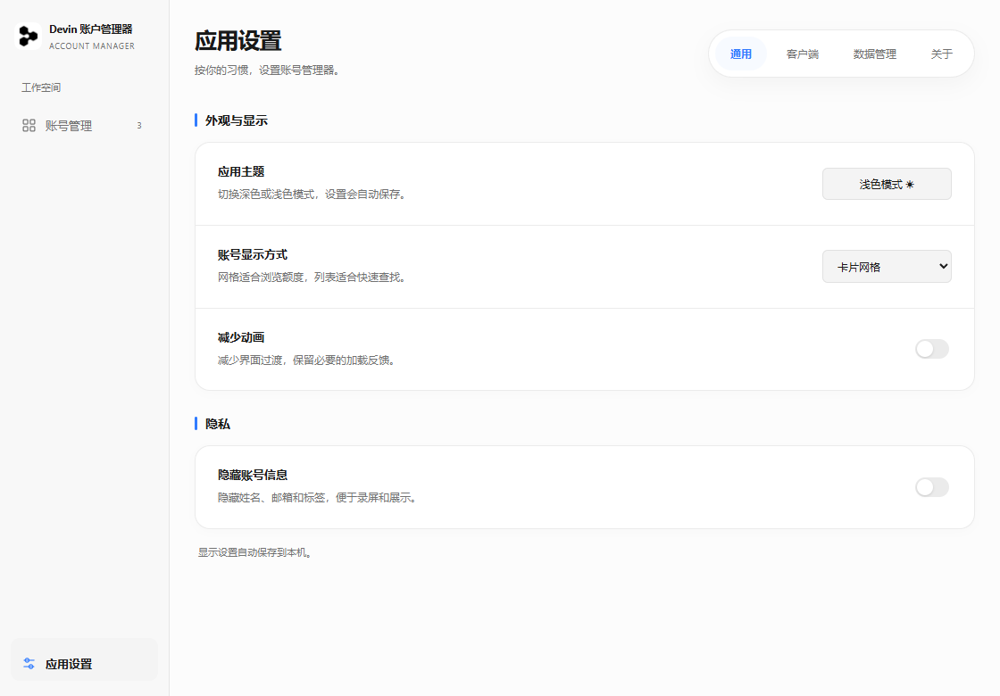

# Devin Account Manager · Devin 账户管理器



**Windows 桌面账号管理工具 · 非官方项目**

[下载最新版本](https://github.com/axinlab71/devin-account-manager/releases/latest) · [上游 Cockpit Tools](https://github.com/jlcodes99/cockpit-tools) · [许可与署名](NOTICE.md)



从 [Cockpit Tools](https://github.com/jlcodes99/cockpit-tools) 提取的精简 Devin Desktop 账号管理应用。核心账号、导入、刷新和客户端会话注入代码来自原项目，并非重新实现一套协议。

## 使用（0.3.2）

1. 打开 Devin Account Manager，点击“添加账号 → 网页授权 → 开始网页授权”。
2. 在系统浏览器完成目标账号登录。
3. 浏览器返回本机授权页面后，应用直接接收本次结果、兑换凭据并自动保存账号，不经过 Devin 客户端。
4. 对其他账号重复上述操作，账号会保存在列表中；点击“切换”才会将对应账号写入并启动 Devin Desktop。
5. 仍支持 Token / Cockpit Tools 原格式 JSON 导入和“导入本机已登录账号”。切换账户前请保存编辑中的文件。

登录本身不要求启动官方客户端；实际切换 IDE 账号仍需要已安装且完成初始化的 Devin Desktop。客户端路径支持 Windows 注册表探测，找不到时可在设置中指定 Devin.exe。

### 网页授权修正依据

官方网页公开脚本对 `http://localhost:PORT/auth`、`http://127.0.0.1:PORT/auth` 有专用登录分支，编辑器登录页会对其保留网页登录而不直接跳入 Devin 客户端流程。原项目 `/windsurf-auth-callback` 没有命中这个分支。静态规则验证记录见 `docs/official-redirect-rules.json`。

本版复用 Cockpit 原有 loopback listener、随机 state、账号 payload 和存储逻辑，改用 `/auth`；采用 fragment 返回，在本机页面清除地址中的凭据后 POST 至同一本机监听器。支持原有 Token 类型、官方一次性 `ott$` / `oidc$` 兑换，以及明确的 `devin_code` 交换。GitHub 中间回调的普通 `code` 不会被当作 Devin 凭据。

没有注册或接管 `devin://`，没有修改服务端允许列表，也没有伪造新的 client_id。授权凭据不写入 pending 文件、不出现在日志中；保存的账号详情仍使用原有加密格式。

**验证范围：**本地回调、额度解析、加密保存和模拟客户端注入有自动化回归测试覆盖。离线测试与程序成功启动不能代替真实账号的完整登录、在线刷新和两账号切换验证；具体范围见 [docs/VALIDATION.md](docs/VALIDATION.md)。

## 0.3.2 三列账号卡片

- 标准窗口与宽窗口最多三列，窄窗口两列，最小窗口一列；新用户默认网格，保留已有视图偏好。
- 姓名与邮箱集中在账号信息区，套餐与当前标识位于下一行；正常状态减少重复提示，异常仍单独显示。
- 额度集中在独立面板，日周剩余与重置时间直接可见；刷新和删除为辅助操作，切换按钮固定在底部右侧。
- 本版范围为卡片布局及状态文案；之前评审中的凭据边界、服务器地址校验和切号恢复仍待专项处理。



## 0.3.1 舒适卡片与独立设置页

- 卡片字号、宽度与操作间距调至适中：1120px 标准窗口为两列，1400px 宽窗口为三列，小窗口为单列；每日/每周重置时间直接显示。
- 应用设置入口固定在侧栏底部，打开独立页面，按「通用 / 客户端 / 数据管理 / 关于」分类。
- 通用页可调整主题、账号显示方式、隐私显示与减少动画；偏好自动保存。
- 客户端路径保存和状态检测、Cockpit / 官方客户端迁移入口、版本与原项目许可分别归入对应分类。
- 沿用原有登录、导入、刷新、迁移和切换核心实现。



## 0.3.0 紧凑布局与迁移

- 卡片缩小，套餐采用彩色标签；日/周额度仍直接可见，重置时间可展开，最近使用时间可在卡片提示中查看。
- Token 与 JSON 合并为自动识别入口，支持读取 .txt / .json 文件（最大 5 MB）。
- 添加账号 → 本地迁移 → 导入 Cockpit 账号：自动查找 ~/.cockpit_tools 或旧版 ~/.antigravity_cockpit，也可填写数据目录。只迁移 Windsurf / Devin，不修改原文件或密钥；重复账号跳过，失败数量单独报告。
- Cockpit 加密文件需要原目录 secure-account-storage.key；受 Windows 保护的密钥只能由原 Windows 用户读取。也可使用 Cockpit 导出的 JSON。
- 主题、版本、存储说明及许可署名集中在应用设置。

## 0.2.1 可靠性完善

- 额度展示已保存的更新时间；旧缓存无时间时明确标记，不将未检查账号显示为在线正常。
- 后端仅把有效数字额度视作新快照，空对象/仅身份信息/无效数值不会覆盖旧额度或更新其时间；剩余零仍属于有效数据。
- 批量刷新显示完成进度，可停止后续任务；已开始的请求正常结束，成功账号立即更新。
- 客户端状态读取失败不会隐藏账号列表；本地账号读取失败提供重试，避免误显示为无账号。
- 刷新失败时额度明确标为上次数据，仍保留原有网页授权、Token/JSON 导入与切换协议。

开发验证：`npm run test:quota`，Rust 回归测试与界面测试命令见下文。

## 0.2.0 额度与布局

- 产品更名为 Devin Account Manager（Devin 账户管理器）。应用标识和原本地数据目录保持兼容，已有账号不需要重新导入。
- 直接复用 Cockpit Tools 的前端数据提取与额度解析，展示每日/每周剩余百分比、Credits 余额/总量、重置时间和已缓存状态，支持 JSON、snake_case 与二进制 protobuf 快照。
- 缺失额度明确显示暂无数据；已用与剩余方向按上游 Rust 解码语义对齐，零剩余不会被当作缺失。
- 移除顶部账号概览、常驻客户端状态条；状态与重新检测放进客户端设置。
- 成功提示右上角显示约 4.5 秒后消失，可提前关闭；错误信息保留，支持关闭。
- 额度通过原有刷新按钮查询，不新增账号协议或复杂图表。

测试：`node scripts/test-quota.cjs`；界面检查脚本见下方开发说明。截图均为合成账号和合成额度，不展示真实用户信息。

## 0.1.5 网络连接修正

本机复现：默认环境代理 127.0.0.1:7897 连接 register.windsurf.com 时 TLS 握手 EOF；同一服务器直连可获得 HTTP 响应。浏览器收到本机回调，只代表授权结果已交付，凭据兑换成功后才会保存账号。

认证请求先沿用原系统/环境代理。仅在建立连接失败（reqwest is_connect）且请求可克隆时，保持同一 URL、请求体和 User-Agent，最多尝试一次直连；不会关闭证书或主机名验证，不修改系统代理。API 请求不自动跟随重定向；收到 HTTP 响应、连接后超时或不可克隆请求均不重发一次性凭据。错误提示只显示故障类别，不包含 Token、响应正文或授权 URL。

升级后请重新点“开始网页授权”，不要刷新旧的本机回调页。

诊断命令：`cargo run --manifest-path src-tauri/Cargo.toml --example network_probe`。只向官方认证域发送无凭据 GET，不读取本地账号文件。

## 0.1.4 Devin 风格界面

- 直接参考本机 Devin Desktop 3.10.48 的 Devin Dark / Devin Light 主题资源，使用中性灰底、细边框与蓝色主操作。
- 窗口、任务栏、安装包和侧栏使用同款黑白图标；品牌归属见 NOTICE。
- 收窄侧栏及顶部概览，移除装饰标语；增大账号名称、邮箱与操作文字，列表采用更紧凑行距。
- 新用户默认深色和列表视图；已有用户的主题及视图偏好继续保留。
- 隐私显示开启时同时清空搜索词，避免搜索框残留姓名或邮箱。
- 授权、导入、存储与账户切换核心源码保持稳定成熟架构。设计资源读取不修改官方客户端或登录数据。

## 0.1.3 界面与管理体验

- 参考 Cockpit Tools 的账号管理交互，增加搜索、筛选、最近使用/最近添加/名称排序及当前账号置顶。
- 网格和紧凑列表两种视图；深浅色主题；隐私显示隐藏姓名、邮箱与标签，偏好只保存在本机。
- 账号概览显示已保存数量、本地匹配的当前账号与需检查数量；出现过期提示或查询异常时标记为“需检查”以便用户一键刷新。
- 刷新全部逐个执行，部分失败会单独标记；不因某个账号失败而中断其他账号。
- 添加弹窗提供网页登录等待/取消状态、Token 和 JSON 文件导入；支持 Escape 关闭、键盘焦点约束及小窗口布局。
- 切换会重启官方客户端，请先保存工作。当前账号可“重新应用”。

界面自动检查：启动 `npm run dev`，设置 `DEVIN_PLAYWRIGHT_PATH` 指向已安装的 Playwright 包目录（或在本地安装 Playwright 包），运行 `node scripts/ui-smoke.cjs`。使用 Edge headless 和合成 IPC 数据，不读取真实账号，不测试真实网页登录或客户端切换。

## 本地数据

数据位于 `%LOCALAPPDATA%\DevinSwitcher`，与 Cockpit Tools 数据目录分开。账号 JSON 格式和调用参数保持兼容；可通过 Cockpit Tools 导出，再导入本应用。加密封装文件需要配套密钥，不能当作普通导出 JSON 直接导入。

账号详情使用上游 AES-256-GCM 封装；Windows 新密钥增加用户级 DPAPI 保护。旧格式密钥仍能读取。新密钥不能复制到另一 Windows 用户直接解密。索引只保存基础信息。认证日志不写入磁盘。

切换账户前自动备份客户端 SQLite 数据库到 `client-backups`。备份包含客户端登录数据，请按敏感文件保护。注入操作采用事务，写入失败回滚。界面“本地当前账号”表示客户端持久化凭据匹配。删除本应用账号不会注销官方客户端，也不会清理切换前备份。

## 开发与构建（Windows）

需要 Node.js、Rust MSVC 工具链、Visual Studio C++ Build Tools 和 WebView2。

```powershell
npm ci
npm run build
cargo test --manifest-path src-tauri/Cargo.toml --locked --lib -- --test-threads=1
npm run tauri -- build --bundles nsis
```

安装包生成在 `src-tauri/target/release/bundle/nsis`。独立版不需要 Go、代理 sidecar 或原项目其他平台组件。

源码分析和调用架构见 [docs/ANALYSIS.md](docs/ANALYSIS.md)，测试验证与规范记录见 [docs/VALIDATION.md](docs/VALIDATION.md)。

## 许可

保留原作者 jlcodes / jlcodes99 署名，遵循 CC BY-NC-SA 4.0；见 [NOTICE.md](NOTICE.md)、[LICENSE.txt](LICENSE.txt) 及保留的上游 README。

## 公开源码说明

此仓库不包含任何真实账号、Token、客户端登录数据库、密钥、OAuth pending 文件或本机运行日志。演示截图和测试使用合成数据。历史本机验证记录保留验证范围说明；运行日志未随公开源码发布。
