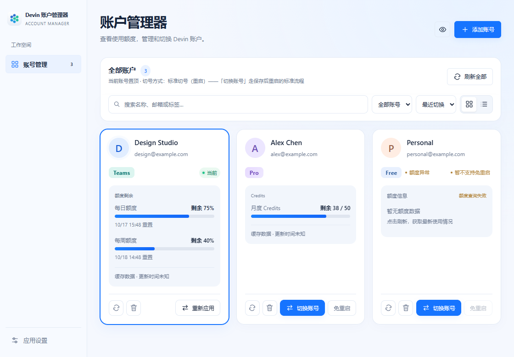

# Devin Account Manager · Devin 账户管理器


面向 Windows 的独立桌面工具，用于管理 Devin Desktop 账号、查看额度、切换账号，以及排查模型列表空白等连接问题。

[下载发布版本](https://github.com/axinlab71/devin-account-manager/releases) · [反馈问题](https://github.com/axinlab71/devin-account-manager/issues) · [源码仓库](https://github.com/axinlab71/devin-account-manager)

> 非官方项目。当前源码版本为 **0.5.2**，功能与可下载发布版本可能存在差异，请以对应 Release 的说明为准。



## 可以做什么

- **账号管理**：网页登录授权、Token / JSON 导入、本机账号导入，以及从 Cockpit Tools 迁移账号。
- **查看使用额度**：按账号可获取的数据展示日周额度、Credits 和重置时间；查询失败或数据过期时明确提示。
- **标准切号**：默认使用保存恢复点后正常关闭并重启客户端的方式，切换前请先保存工作。
- **尝试免重启切号**：实验性功能，依赖账号凭据和官方客户端兼容性；可能需要在 Devin 中确认，不能保证正在运行的 AI 任务不中断。
- **额度监控与推荐**：根据可信额度数据和备用账号池提醒、推荐账号，由用户确认后切换。全自动模式尚未开放。
- **模型列表诊断与恢复**：左侧「诊断与恢复」提供网络、代理、PAC 和近期日志检查，报告预览与导出，以及按需恢复操作。

## 开始使用

1. 从 [Releases](https://github.com/axinlab71/devin-account-manager/releases) 下载并安装可用版本。
2. 安装并初始化官方 Devin Desktop。在「应用设置 → 客户端」检测或填写 `Devin.exe` 路径。
3. 点击「添加账号」，选择网页登录或导入方式。账号凭据在本机加密保存。
4. 查看账号额度，选择目标账号进行切换。默认切号会重启 Devin，请先保存工作。
5. 如需尝试免重启，在「应用设置 → 客户端 → 切号方式」主动开启；不满足条件时继续使用标准切号。

同邮箱不同组织的账号分别管理；本地身份匹配不能独立证明服务端组织和 AI 请求身份，切换后请在官方客户端核对。

## 导出账号和 Token

账号页右上角点击「导出 Token」，或进入「应用设置 → 数据管理 → 导出账号与 Token」。选择需要的账号、文件格式，确认明文凭据提示后导出；可打开导出目录取走文件。

- **JSON（推荐）**：保留账号、组织与刷新凭据，可通过「添加账号 → Token / JSON」重新导入。
- **TXT**：每行一个 Token，优先长期凭据，不保留组织信息；部分短期 Token 可能过期。仅有一次性凭据时会拒绝 TXT 导出。

文件保存在 `%LOCALAPPDATA%\DevinSwitcher\exports\credentials`，没有加密。不要放进日志包、公开仓库或发送给不可信的人；导出不会联网刷新、修改官方登录状态，也不会将凭据显示在前端。

## 模型列表不显示时

打开左侧 **「诊断与恢复」**，按顺序处理：

1. 先运行诊断、预览脱敏报告，保留故障发生时的证据。
2. 如建议重载 ACP，点击「复制命令」和「打开 Devin」，在 Devin 中按 `Ctrl+Shift+P`，粘贴 `Reload ACP Connections` 并执行。管理器不会自动执行该官方命令。
3. 仅在需要时填写实际 HTTP 代理端口并确认用途。写入前进行 CONNECT 探测、备份配置；支持撤销本次代理修改。
4. 最后才考虑保存工作后重启官方客户端。用户取消关闭或等待超时会中止，不强杀进程。
5. 温和重启无效时，可选择「彻底重启」：先导出日志，再强制结束已核实属于当前安装的进程及其子进程（包括终端、AI 任务），重新启动。必须确认风险；不清除登录文件、认证数据库或缓存，也不能保证修复网络或服务端故障。
6. 在 Devin 中确认模型列表出现且能正常发消息，再反馈恢复结果。

无需先运行诊断即可点击「导出 Devin 日志包」。导出包含 IDE 与 agent 最近日志的脱敏 ZIP（最多 40 个文件，每个截取末尾 512 KiB），并保留同名目录供检查。不可读、非文本和超出范围的文件会跳过并在清单中说明。日志可能仍含项目名、代码等私人信息，请检查后再分享。二维码仅在本 README 展示，不嵌入软件。

模型空白可能涉及网络、认证、组织权限或服务端状态。本工具提供诊断和恢复辅助，不能保证修复所有原因；连接成功或配置写入成功也不代表模型已恢复。

## 使用支持与交流

遇到问题可在 [GitHub Issues](https://github.com/axinlab71/devin-account-manager/issues) 描述版本、复现步骤和错误信息，也可通过下方二维码联系维护者。

<table>
  <tr>
    <th>售后交流群</th>
    <th>个人微信</th>
  </tr>
  <tr>
    <td align="center"></td>
    <td align="center"></td>
  </tr>
  <tr>
    <td align="center">交流使用问题与故障排查</td>
    <td align="center">联系维护者，请备注项目名称和来意</td>
  </tr>
</table>

群二维码可能失效，失效后可通过个人微信联系。请勿发送账号密码、Token、Cookie、密钥或完整登录数据库；分享诊断报告前请先预览内容。

## 数据与安全

- 应用数据保存在 `%LOCALAPPDATA%\DevinSwitcher`，与 Cockpit Tools 数据目录分开。
- 账号详情加密保存，Windows 新密钥由当前 Windows 用户保护。不要直接复制密钥和加密数据库到其他用户配置。
- 标准切号保留加密恢复点；设置页提供恢复入口，恢复前请核对提示并保存工作。
- 不修改官方扩展、不接管 `devin://`、不重置机器 ID，也不改变官方默认凭据存放位置。
- 诊断会保存本机脱敏结果；代理修复必须由用户主动确认，修改前备份，并支持撤销。

## 开发与构建

需要 Node.js、Rust MSVC、Visual Studio C++ Build Tools 和 WebView2。

```powershell
npm ci
# 开发客户端（会自动启动 Vite）
npm run tauri -- dev
# 可独立运行的正式 exe（无需本地开发服务器）
npm run build:desktop
# NSIS 安装包
npm run tauri -- build --bundles nsis
```

独立程序位于 `src-tauri/target/release/devin-account-manager.exe`，安装包位于 `src-tauri/target/release/bundle/nsis`。

**请使用 Tauri 构建命令。普通、不带 custom-protocol 的 `cargo build --release` 产物可能仍访问 localhost，不能作为正式客户端交付。**

验证命令：

```powershell
cargo test --locked --manifest-path src-tauri/Cargo.toml --lib -- --test-threads=1
npm run build
npm run test:quota
# 另开终端运行 npm run dev 后执行合成界面回归
node scripts/ui-smoke.cjs
```

自动化测试覆盖离线逻辑和模拟界面；真实登录、切号、模型故障恢复需另行现场验收。详见 [审核交接](docs/REVIEW_HANDOFF.md)、[真实验收步骤](docs/ROTATION_VALIDATION.md) 和 [技术交接](docs/AI_HANDOFF.md)。

## 项目来源与许可

本项目从 [Cockpit Tools · jlcodes99](https://github.com/jlcodes99/cockpit-tools) 提取并继续开发，保留上游账号管理、导入、刷新等核心实现与署名。

遵循 **CC BY-NC-SA 4.0**，包含非商业使用限制。详情见 [LICENSE.txt](LICENSE.txt)、[NOTICE.md](NOTICE.md) 和 [上游 README](docs/UPSTREAM-README.md)。Devin 名称、图标及商标归原权利人所有。
