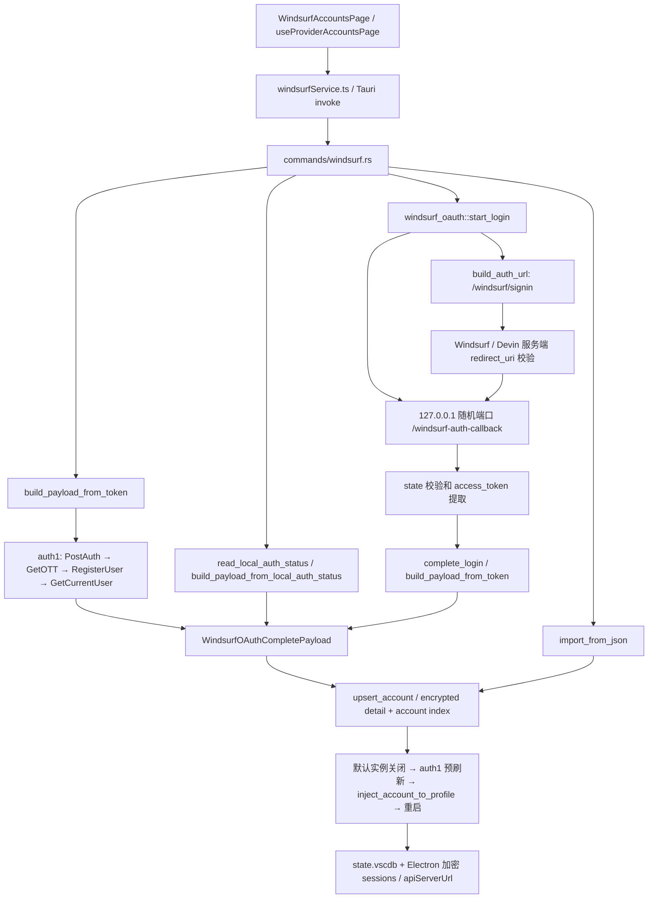

# Devin Account Manager 源码分析

## 0.1.2：直接网页授权，不经过 Devin Desktop

用户明确要求“在账户管理器点击网页授权，网页登录后直接保存账号，不经过 Devin 客户端”。0.1.1 的客户端代收回调不符合这一目标，0.1.2 已切换主入口。

新的源码证据来自 Windsurf 官网公开脚本 `51107-91955e0efb5a8323.js` 及编辑器 signin 页面脚本：通用 loopback URL 检查对旧路径和 `/auth` 都返回 true；但仅 `/auth` 命中专用 Db 规则，signin 页面据此设置其自有 `no_redirect` 登录分支。原 `/windsurf-auth-callback` 没有命中，随后进入用户观察到的 app.devin.ai 跳转并遭拒。之前直接下结论“本应用无法使用直接网页授权”不充分，遗漏了这条官方网页分支。

已在 Node VM 中只执行官网的纯 URI 分类函数，记录见 `official-redirect-rules.json`。这验证前端分支差异，不证明登录后的服务端也已实测通过。

实际修改：复用原 `windsurf_oauth` listener 和状态结构；启动时先绑定 `127.0.0.1:0`，再生成 `/auth` 回调，避免端口释放竞态；沿用原 Windsurf signin 入口和 client_id；采用 fragment，静态本机页清除 hash 并同源 POST，校验随机 state；query 回调保留兼容。收到的 access_token / devin_code 只留内存，pending 落盘前剥离凭据。

明确区分 GitHub `/auth/callback?code=...` 和最终 Devin 回调。只有 `devin_code` 才调用官方客户端的 `ExchangeDevinCode` 方法；`ott$` / `oidc$` 调官方 `RegisterUser(firebase_id_token)`，使用上游 Devin 刷新模块的注册 UA；然后复用原 payload / upsert / 切号函数。普通 GitHub code 不接收为 Devin Token。不抓取 GitHub 密码、Cookie 或其他账号会话。

用户界面已改成“开始网页授权 → 网页登录 → 自动入库”，登录期间不启动或读取客户端。官方客户端本地导入仍为独立备用操作。回调接收不等于成功保存：本机页只提示已接收结果，账户管理器完成服务端兑换并保存后才报告完成。

以下 0.1.0/0.1.1 内容作为分析历史保留，当前实现以上述直接流程为准。

**0.1.1 更新：**用户提供了实际客户端的 `/devin/account/login` URL，明确指出需要从软件直接发起网页登录。本版新增 `modules/official_browser_login.rs`：使用这一已证实的官方分支，保留官方深链和参数，生成新 state，启动默认浏览器；官方客户端处理回调并保存新会话后，本应用自动调用原有 payload/账号保存流程。原 localhost 第三方回调仍不可用，但“由官方客户端接收回调的网页登录”不应被一并描述为不可用。以下初版限制分析针对第三方直接接收 OAuth 回调。

本版还补齐只读会话检测：官方会话可能存在于 `secret://{"extensionId":"codeium.windsurf","key":"windsurf_auth.sessions"}`，`windsurfAuthStatus=null` 不能单独证明未登录。新增读取复用上游 Local State / DPAPI / AES-GCM 辅助函数，检测会话变化后剥离临时观察字段，再调用上游本地导入。没有改写网页登录协议、接管官方 URI 或在浏览器中抓取凭据。

该方式的边界：独立版无法验证官方客户端内部 pending-state，只生成自己的观察会话标识；官方客户端根据其现有逻辑对不匹配的外部 state 弹出账号确认，由用户明确确认。独立版依据本地新会话判断导入时机，不能将此称为其自己完成了 OAuth state 校验。登录期间如另行手动登录或切换官方客户端，也可能被检测为新的本地会话。

基线：jlcodes99/cockpit-tools，提交 915e7a20b432546660c3cd15e90f9fa527490ecc，2026-10-15。
原仓库保留在 ../cockpit-source，独立版放在 ../devin-switcher。

## 调用关系

## 授权问题

实际桌面代码位于 src-tauri/src，crates/cockpit-core 存在另一份实现，不能混用两份版本。
src-tauri/src/modules/windsurf_oauth.rs:375 的 build_auth_url 使用旧固定 client_id，response_type=token，redirect_parameters_type=query，workflow=onboarding。
start_login 使用 find_available_port 生成 http://127.0.0.1:PORT/windsurf-auth-callback，生成独立 login_id / state，启动 tiny_http 回调，最长等待 600 秒。
本地回调检查 state 后接收 access_token；不涉及 authorization-code + PKCE。
用户报告的 Invalid redirect URI 发生于 app.devin.ai/auth/windsurf/continue，早于本地回调；换端口或修改 state 无法让服务端接受未获授权的回调地址。

公开、不带账号凭据的 HTTP 复现：旧入口返回 200，最终地址为 windsurf.com/editor/signin，页面内容为 Redirecting。这不是授权成功。公开脚本显示会检查 redirect_uri 后选择登录入口。
本次直接请求 app.devin.ai 失败于 TLS 握手，因此尚未在本机浏览器独立复现服务端错误，也未确认其完整允许列表。
不能从一个拒绝结果推断 Devin 永久不支持全部第三方 OAuth；当前没有本项目获注册的回调/client 配置，也没有查到可用于本应用的公开 OAuth 注册流程。

官方文档 https://docs.devin.ai/desktop/getting-started 明确支持客户端登录及手动输入 Devin API key。安全替代路线是先在官方客户端完成其自有登录，再由原有本地导入代码读取当前登录态；不冒用官方域名或猜测 client_id。
独立版应停止生成已知不兼容的旧授权请求，明确提示限制，并提供打开官方客户端、导入当前账号和 Token/JSON 导入。这属于替代方案，不宣称修复了第三方 OAuth。

## 保留源码与依赖

| 文件 | 用途 / 处理 |
| --- | --- |
| src-tauri/src/models/windsurf.rs | 完整保留账号与 payload 数据结构（历史 github/copilot 字段是兼容格式） |
| src-tauri/src/modules/windsurf_oauth.rs | 保留 Token、本地登录态、刷新协议；禁止旧浏览器授权入口 |
| src-tauri/src/modules/windsurf_devin_oauth.rs | 保留 auth1/session/IDE token 转换和刷新 |
| src-tauri/src/modules/windsurf_account.rs | 保留 JSON、索引、去重、账号保存、删除、刷新、本地读取；移除额度告警 |
| src-tauri/src/modules/windsurf_instance.rs | 保留默认目录探测、Electron 加解密、会话注入、进程识别、关闭与启动；移除多实例管理 |
| src-tauri/src/modules/secure_account_storage.rs | 保留 AES-GCM 账号详情存储 |
| src-tauri/src/modules/atomic_write.rs | 保留原子写入、备份和恢复 |
| src-tauri/src/modules/account_index_repair.rs | 保留索引恢复 |
| src-tauri/src/modules/deferred_account_rewrite.rs | 保留后台加密迁移 |
| src-tauri/src/modules/client_version.rs | 保留客户端版本探测 |
| src-tauri/src/modules/oauth_pending_state.rs | 旧协议内部依赖，未开放授权入口 |
| src-tauri/src/utils/protobuf.rs | 保留原 protobuf 编解码 |
| src/services/windsurfService.ts / src/types/windsurf.ts | 保留调用名称、参数与账号类型 |
| src-tauri/src/commands/windsurf.rs | 提取账号操作命令；移除 tray、额度告警、批量密码与 VS Code 展示命名 |
| src-tauri/src/commands/windsurf_instance.rs | 提取默认实例切号顺序；移除多实例 UI/命令 |
| src/pages/WindsurfAccountsPage.tsx | 参考调用契约，替换跨平台通用页面依赖为单页 UI |

Rust 直接依赖：tauri 2、serde/json、reqwest、tokio、chrono、dirs、rusqlite bundled、rand、url、uuid、md5、base64、sha2、aes-gcm、fs2、tiny_http、Windows Cryptography；跨平台原代码另有 aes/cbc/pbkdf2/sha1。
前端直接依赖：React、React DOM、TypeScript、Vite、@tauri-apps/api；不需要原来的多平台页面、统计图表、代理 sidecar、更新服务。
原许可为 CC BY-NC-SA 4.0，独立版必须保留 jlcodes 署名、来源、修改说明和相同许可，不可按普通 MIT 项目分发。

## 本机官方客户端对照结果

通过 Windows 卸载注册表找到 `E:\Devin\Devin.exe`，版本 **3.10.48**。只读检查其 `resources/app/product.json` 和 `resources/app/extensions/windsurf/dist/extension.js`，未修改客户端代码或登录态。

- product.json 的 urlProtocol 为 `devin`；扩展 publisher/name 为 `codeium` / `windsurf`。
- 官方 redirectUri getter 使用 `${env.uriScheme}://${publisher}.${name}`，对应 `devin://codeium.windsurf`。
- Devin 可访问分支直接打开 `https://app.devin.ai/auth/windsurf/continue`，参数包含官方深链、`prompt=select_account` 和 UUID state。
- 官方回调解析 `devin_code`（query 或 fragment），随后调用 SeatManagementService 的 `ExchangeDevinCode`；旧兼容分支才解析 fragment 的 `access_token`。
- Cockpit 旧流程则期待 localhost 回调中的 query `access_token`。除了 redirect_uri 不受当前入口接受，还存在返回载荷协议不匹配。不能仅换 URL 修复。
- 本应用没有注册/接管官方 `devin://` 协议，没有将它伪装成自己的回调，也没有猜测新的 client_id。

这证明当前官方客户端具有自己的浏览器登录方式；不能据此推断它允许任意第三方 loopback/custom-scheme 接入。独立版采用官方客户端登录后本地导入的替代路线。真实登录与切号按用户后续指示暂缓。

## 实际提取后的必要修改

- `windsurf_oauth::start_login` 立即返回清晰的受限说明，不创建旧回调 listener 或 pending 文件；其余原有 Token、本地导入、刷新函数保留。
- 新增极小的 account/config/process 适配层，替代原项目全平台账户配置、托盘、代理环境、多实例和提权依赖。Windows 注册表发现支持非 C 盘安装。
- `windsurf_account` 移除额度告警，并验证账号 ID，防止导入 JSON 通过路径字符越出存储目录。
- `windsurf_instance` 保留默认客户端会话注入和生命周期代码，移除多实例 CRUD；注入时增加 SQLite 事务，避免加密失败产生半写入状态。
- 账号详情保留 AES-GCM envelope 格式，Windows 新密钥增加 DPAPI 封装；保持旧密钥可读。UI 不打印或上传凭据。
- 切号命令在 auth1 预刷新失败时中止，而不是沿用原先的过期凭据降级；关闭客户端前检查程序与数据文件，写入前备份数据库，写入后核对本地目标身份。
- 前端只保留 WindsurfAccount 接口和实际用到的单页功能；历史字段名保留是为了原有账号 JSON 兼容。

原项目基线 `cargo check -p cockpit-tools --locked` 未通过：其 build.rs 构建 cockpit-cliproxy 时，Go 1.26 工具链校验下载遇到 sum.golang.org EOF。未修改原项目绕过此问题。独立版不包含该 sidecar，独立 Rust check 与离线测试通过。

## 验证边界

源码分析不等于功能测试通过。真实 Token、官方客户端登录、切换两个真实账号都需要本地客户端及用户持有凭据；不得用假 Token 的离线测试冒充真实登录验证。

## 0.1.5：回调之后 RegisterUser 发送失败

用户截图中的本机 /auth 页面已经收到凭据；失败发生在后端 RegisterUser 的 HTTPS 发送步骤，尚未验证或保存账号。

同机无凭据复现（不读取账号或提交 Token）：

- 系统/环境代理为 127.0.0.1:7897。原 reqwest 客户端经代理连接 register.windsurf.com，is_connect=true，源错误 unexpected EOF during handshake。
- no_proxy 客户端访问同域根路径获得 HTTP 404，证书/主机名仍正常验证。
- 后续原代理短暂恢复获得 404，再次检查又复现握手 EOF，属于间歇性代理链路问题。
- 新传输层访问 RegisterUser 路径（无凭据 GET）获得 HTTP 405；强制使用一个本机已关闭的代理端口，再通过新层直连，也获得 HTTP 405。405 仅表示 GET 方法不被该 RPC 接口支持，同时证明 TLS/HTTP 已通，不表示真实凭据兑换成功。

仅在连接未建立且请求可克隆时单次直连，保留 URL、body、Content-Type、认证头以及上游默认/显式 User-Agent。认证 API 禁止自动跟随重定向，避免服务响应之后再把 OTP 发回原端点；HTTP 拒绝及连接后的超时不会触发新的直连重发。没有更换 OAuth client_id、redirect_uri、账户格式或关闭 TLS 校验。

完整真实账号授权与两账号切换仍须用户在新版本重新验证。
